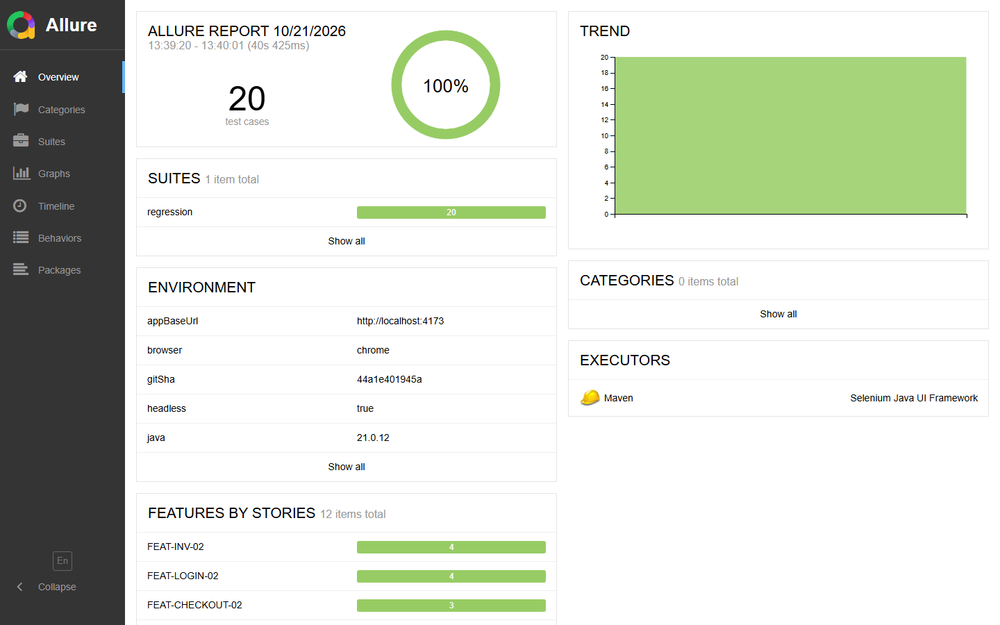
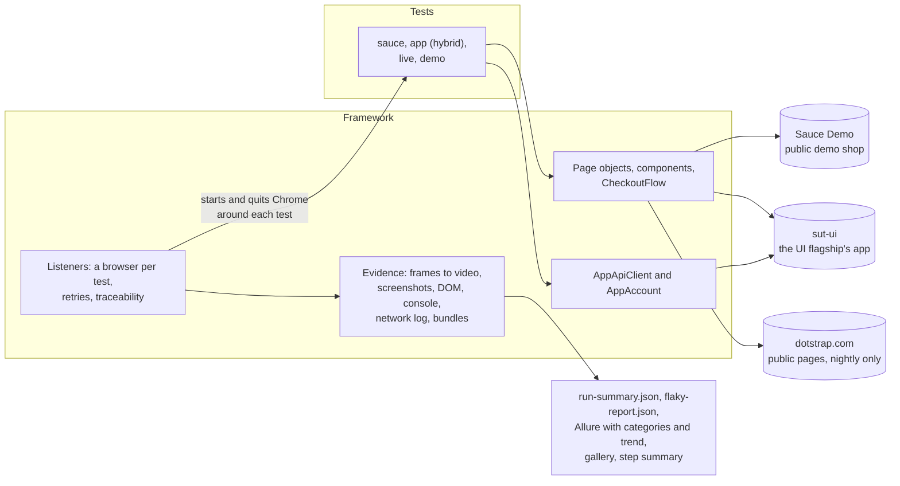

# selenium-java-testng-ui-Dotstrap-Automation

UI test automation with Selenium 4, Java 21 and TestNG: page objects and components, one browser
per test, explicit waits only, data-driven and hybrid tests, a polite live smoke of a production
site, and failure evidence with video, logs and bundles. The lite Selenium member of a family of
four repositories.

[](https://github.com/kesireddy-kishore-29/selenium-java-testng-ui-Dotstrap-Automation/actions/workflows/ci.yml)
[](https://github.com/kesireddy-kishore-29/selenium-java-testng-ui-Dotstrap-Automation/actions/workflows/nightly.yml)
[](https://github.com/kesireddy-kishore-29/selenium-java-testng-ui-Dotstrap-Automation/actions/workflows/nightly.yml)
[](https://kesireddy-kishore-29.github.io/selenium-java-testng-ui-Dotstrap-Automation/)



| | |
|---|---|
| Tests | 20 runs of 12 browser tests in the regression, 3 in the smoke, 17 runs of 4 checks in the live smoke, 3 deliberate failures, 54 framework unit tests; all passed in the latest local runs (the deliberate failures failed, as designed) |
| Run time | About 41 s for the regression on a laptop, three browsers at a time; about a minute for the live smoke, one browser |
| Features traced | 17 feature IDs, shared with the other repositories; a browser test without one stops the suite before it starts |
| Status | Verified locally on Windows 11 with headless Chrome. The workflows pass actionlint and shellcheck but **have not run on GitHub yet**, and the Selenium Grid video option has never run ([known issues](docs/known-issues.md)) |

## Standards demonstrated

| Practice | Where it is |
|---|---|
| Page objects and components with a written locator policy | [`pages/`](src/main/java/com/qaautomation/selenium/pages/), [`components/`](src/main/java/com/qaautomation/selenium/components/), [docs/locator-policy.md](docs/locator-policy.md) |
| Accessible role and name checked, not just presence | [`Accessible`](src/main/java/com/qaautomation/selenium/pages/Accessible.java) (`getAriaRole()`, `getAccessibleName()`) |
| One browser per test, thread-safe, started and quit by a listener | [`DriverFactory`](src/main/java/com/qaautomation/selenium/core/DriverFactory.java), [`EvidenceListener`](src/main/java/com/qaautomation/selenium/listeners/EvidenceListener.java) |
| Explicit waits only; hard and implicit waits refused by Checkstyle | [`WaitHelper`](src/main/java/com/qaautomation/selenium/core/WaitHelper.java), [`checkstyle.xml`](config/checkstyle/checkstyle.xml) |
| A fluent flow for a multi-page journey | [`CheckoutFlow`](src/main/java/com/qaautomation/selenium/flows/CheckoutFlow.java) |
| Data-driven tests whose cases read as names in reports | [`LoginTest`](src/test/java/com/qaautomation/selenium/tests/sauce/LoginTest.java), [`InventoryTest`](src/test/java/com/qaautomation/selenium/tests/sauce/InventoryTest.java), [`CheckoutTest`](src/test/java/com/qaautomation/selenium/tests/sauce/CheckoutTest.java) |
| Session seeded by cookie; only sign-in tests use the form | [`SauceSession`](src/main/java/com/qaautomation/selenium/pages/sauce/SauceSession.java) |
| Hybrid test: seed through the API, check the UI, cleanup verified | [`ItemsTest`](src/test/java/com/qaautomation/selenium/tests/app/ItemsTest.java), [`AppAccount`](src/main/java/com/qaautomation/selenium/clients/AppAccount.java) |
| Configuration validated at start-up, every problem at once | [`ConfigLoader`](src/main/java/com/qaautomation/selenium/config/ConfigLoader.java) |
| Failure evidence: stitched video, screenshots, DOM, console, network log, bundles | [`evidence/`](src/main/java/com/qaautomation/selenium/evidence/), [example](docs/examples/failure-evidence/) |
| Redaction of credentials in everything evidence writes | [`Redactor`](src/main/java/com/qaautomation/selenium/core/Redactor.java) and its unit tests |
| Retries capped at two; a pass on retry is reported as flaky | [`RetryAnalyzer`](src/main/java/com/qaautomation/selenium/listeners/RetryAnalyzer.java), `flaky-report.json` |
| Requirements traceability, enforced | [`TraceabilityListener`](src/main/java/com/qaautomation/selenium/listeners/TraceabilityListener.java) |
| Quarantine with owner and expiry, enforced by a unit test | [`quarantine.json`](quarantine.json), [`QuarantinePolicy`](src/main/java/com/qaautomation/selenium/listeners/QuarantinePolicy.java) |
| Allure with triage categories, environment and trend | [`categories.json`](config/allure/categories.json), [`allure-report.sh`](scripts/allure-report.sh) |
| A live production smoke that never gates and never signs in | [`PublicSiteTest`](src/test/java/com/qaautomation/selenium/tests/live/PublicSiteTest.java), [`live-pages.json`](src/main/resources/config/live-pages.json) |
| CI: pull-request gate, nightly with Pages and a live badge, optional Grid video | [`.github/workflows/`](.github/workflows/) |
| Quality gates | `-Werror` (no raw types or unchecked casts), Spotless, Checkstyle, Enforcer, lefthook, Conventional Commits, a 2 MB file guard |

## Architecture



## What is tested

| Suite | Tests | What it covers | Target |
|---|---|---|---|
| `smoke` | 3 | Sign in, the product list, a full checkout | Sauce Demo |
| `regression` | 12 tests, 20 runs | Sign-in (valid, 4 invalid cases, locked out), product list, 4 sorts, product detail, cart badge, checkout (full, 3 missing fields, order arithmetic), logout; one hybrid test on a table and a dialog | Sauce Demo, sut-ui |
| `live` | 4 checks, 17 runs | 9 public pages answer 200 with their heading; no console errors or failed requests; title, description and canonical URL; no horizontal overflow at 1440, 1024, 768 and 390 px | dotstrap.com, nightly only |
| `demo-failure` | 3 | Fails on purpose: a wrong expectation, a missing element, a wait that times out | Sauce Demo |
| `unit` | 54 | The framework itself: configuration, redaction, log parsing, video, locator extraction, test ids, traceability, quarantine, reports | none |

## Traceability

Every browser test carries `@Feature("FEAT-…")`, also an Allure feature label. The IDs are the
family's: the same scenario has the same ID in every repository. "Family" counts the area's IDs
across the family; "Here" counts those this repository covers.

| Area | Family | Here | Tests | Runs | Suite |
|---|---|---|---|---|---|
| Sign-in and logout (`LOGIN`, `LOGOUT`) | 4 | 4 | 4 | 7 | smoke, regression |
| Inventory (`INV`) | 3 | 3 | 3 | 6 | smoke, regression |
| Cart (`CART`) | 2 | 1 | 1 | 1 | regression |
| Checkout (`CHECKOUT`) | 3 | 3 | 3 | 5 | smoke, regression |
| Items, hybrid (`ITEMS`) | 1 | 1 | 1 | 1 | regression |
| Live smoke (`LIVE`) | 8 | 4 | 4 | 17 | live |
| Deliberate-failure demo (`DEMO`) | 1 | 1 | 3 | 3 | demo-failure |
| **Total** | **22** | **17** | **19** | **40** | |

`FEAT-CART-02` (the cart survives navigation) and the other four live checks are covered by the
UI flagship.

## Design decisions

- Selenium with Java and TestNG, from a job-market analysis, in a repository of its own
  ([ADR 1](docs/adr/0001-why-selenium-java-testng.md)).
- One browser per test in a `ThreadLocal`, owned by a listener ([ADR 2](docs/adr/0002-thread-local-browser.md)).
- Explicit waits only ([ADR 3](docs/adr/0003-explicit-waits-only.md)).
- Video stitched from screenshots by default; the Grid's recorder as an option ([ADR 4](docs/adr/0004-video-stitch-or-grid.md)).
- The live smoke is a polite, read-only visitor ([ADR 5](docs/adr/0005-live-smoke-policy.md)).
- Test ids first, then id or name; roles and names are checked, not searched ([ADR 6](docs/adr/0006-test-ids-then-accessible-checks.md)).

## Failure evidence

`RECORD_MODE` decides how much each test keeps: `failures` (the default), `all` (nightly and local
analysis), `off`. A kept attempt has a video stitched from a screenshot after every page action,
the viewport and full-page screenshots, the redacted page source, the console log, a network log
from Chrome's performance log (no headers) and `meta.json`. A failed test also gets a failure
bundle (every attempt and a README) and a zip; the run gets `run-summary.json`,
`flaky-report.json`, a gallery page (the same page as the flagships) and a step summary.

The `demo-failure` suite fails on purpose. A bundle from a real run of it, with both attempts'
videos, is in [docs/examples/failure-evidence](docs/examples/failure-evidence/); Allure sorts the
three failures into `LOCATOR_DRIFT`, `PRODUCT_BUG` and `TIMING`
([screenshot](docs/examples/allure/categories.png)).

## Real-world origin

The scenarios come from the author's own production project, [dotstrap](https://dotstrap.com):
reusing a signed-in session instead of signing in per test, seeding data through the API and
proving it gone afterwards, and reading what a public page really renders at four widths instead of
trusting a 200. They are rebuilt from scratch against a public demo shop and the UI flagship's
self-hosted app; no dotstrap code, configuration or data is used.

The only contact with dotstrap itself is the live smoke: public pages only, no sign-in, no forms,
no data created, no calls to its backend, one browser at a time, a user agent that names this
project, never gating a merge. Its evidence is never published or committed.

## Family of repos

- [**restassured-testng-api-Dotstrap-Automation**](https://github.com/kesireddy-kishore-29/restassured-testng-api-Dotstrap-Automation): the API flagship in Java with REST Assured and TestNG: contract, functional, security and resilience suites, triage, governed self-healing and a health dashboard.
- [**playwright-typescript-ui-Dotstrap-Automation**](https://github.com/kesireddy-kishore-29/playwright-typescript-ui-Dotstrap-Automation): the UI flagship in TypeScript with Playwright, where the Sauce Demo scenarios, the self-hosted app and the full live smoke come from.
- **selenium-java-testng-ui-Dotstrap-Automation** (this one): the same Sauce Demo scenarios in Selenium 4 and Java, with the same feature IDs.
- [**Python-pytest-playwright-Dotstrap-Automation**](https://github.com/kesireddy-kishore-29/Python-pytest-playwright-Dotstrap-Automation): API and UI tests in Python with pytest and Playwright for Python.

## How to run

You need Java 21 and Chrome; Selenium Manager fetches the matching driver. ffmpeg on the `PATH`
turns frames into videos (without it, the frames are kept as screenshots).

```bash
./mvnw verify -Dsuite=unit           # format check, Checkstyle, compile, unit tests
./mvnw test -Dsuite=smoke            # three journeys on Sauce Demo
./mvnw test -Dsuite=regression       # everything but live and demo; the hybrid test skips
                                     # unless the UI flagship's app runs on :4173
./mvnw test -Dsuite=live             # dotstrap.com public pages, one browser
./mvnw test -Dsuite=demo-failure     # fails on purpose
scripts/allure-report.sh             # Allure with trend history
```

Switches: `RECORD_MODE=failures|all|off`, `RUN_ID=<id>`, `TEST_RETRIES=0..2`,
`VIDEO_MODE=stitch|grid|off` (with `GRID_URL`), `-Pci` for the CI profile; any configuration key as
an environment variable (`sauce.baseUrl` → `SAUCE_BASE_URL`). Evidence lands in
`run-evidence/selenium-java-testng-ui-Dotstrap-Automation/<run-id>/`. More in the [test strategy](docs/test-strategy.md),
[locator policy](docs/locator-policy.md) and [known issues](docs/known-issues.md).
