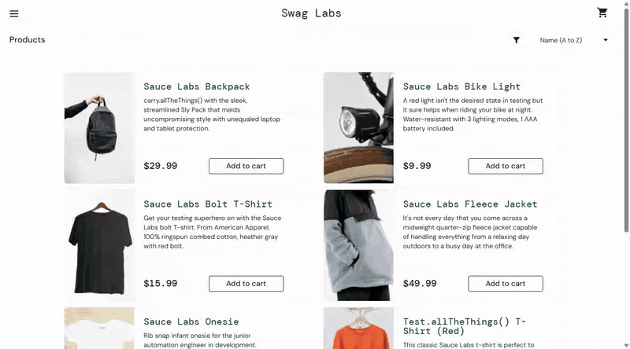
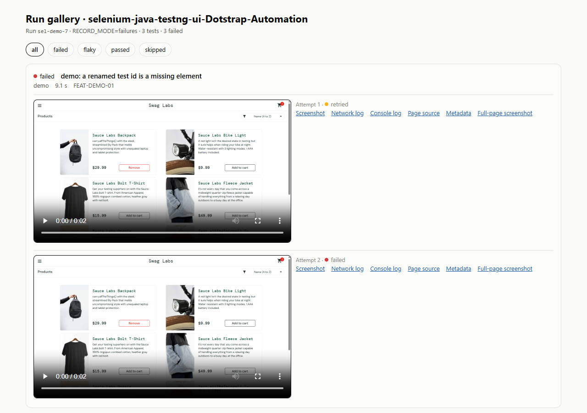
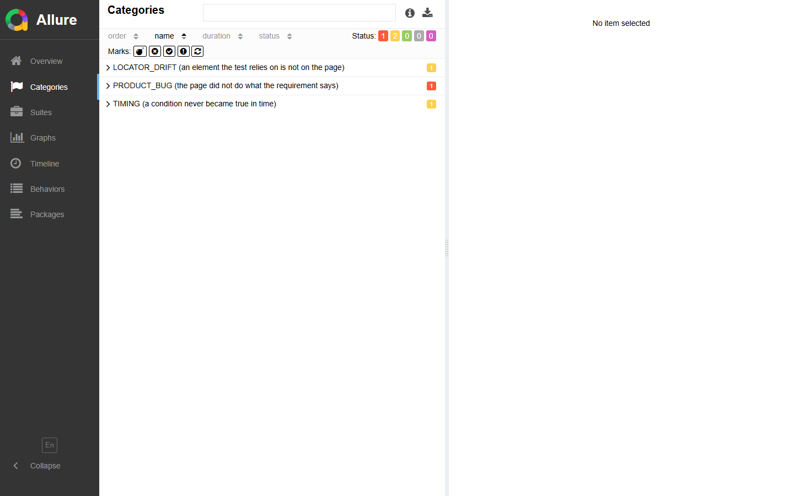
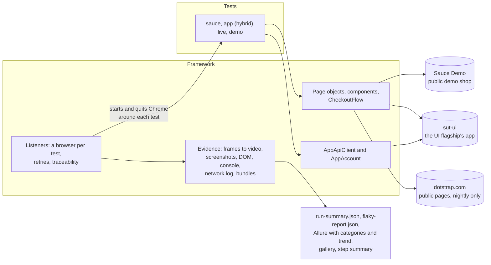

# selenium-java-testng-ui-Dotstrap-Automation

Production-style Selenium framework: Java 21, Selenium 4, TestNG, Allure, GitHub Actions, with page
objects and components, one browser per test, explicit waits only, a polite live smoke, and failure
evidence with video, logs and bundles. The lite Selenium member of a family of four repositories.

[](https://github.com/kesireddy-kishore-29/selenium-java-testng-ui-Dotstrap-Automation/actions/workflows/ci.yml)
[](https://github.com/kesireddy-kishore-29/selenium-java-testng-ui-Dotstrap-Automation/actions/workflows/nightly.yml)
[](https://github.com/kesireddy-kishore-29/selenium-java-testng-ui-Dotstrap-Automation/actions/workflows/nightly.yml)
[](https://kesireddy-kishore-29.github.io/selenium-java-testng-ui-Dotstrap-Automation/)
[](LICENSE)
[](pom.xml)
[](pom.xml)
[](pom.xml)

## See it in 60 seconds

- **Live report:** [Allure with trend and the run gallery](https://kesireddy-kishore-29.github.io/selenium-java-testng-ui-Dotstrap-Automation/),
  published by the nightly run. _CI status: first run pending; the images below are from real
  local runs._
- **If you only have 60 seconds**, open:
  1. [`CheckoutTest`](src/test/java/com/qaautomation/selenium/tests/sauce/CheckoutTest.java) and the
     [`CheckoutFlow`](src/main/java/com/qaautomation/selenium/flows/CheckoutFlow.java) it drives.
  2. [A failure bundle](docs/examples/failure-evidence/): two attempts, each with video,
     screenshots, page source, network log and metadata.
  3. [ADR 2, one browser per test](docs/adr/0002-thread-local-browser.md): how parallel runs stay
     independent.




## At a glance

| | |
|---|---|
| Tests | **20** runs of 12 browser tests in the regression, 3 in the smoke, **17** runs of 4 checks in the live smoke, 3 deliberate failures; **54** framework unit tests |
| Features traced | **17** feature IDs, shared with the other repositories; a browser test without one stops the suite before it starts |
| Runs verified | 2 regression runs (`sel-allure-3`, `sel-allure-4`), 20/20 each, on 2026-10-22 at commit `7cf5ac6`; live smoke 17/17 at the same commit on 2026-10-21 (Windows 11, headless Chrome 154) |
| Flaky tests | 0 over those 2 runs (a pass on retry is reported as flaky) |
| Stack | Java 21, Selenium 4.51 (Selenium Manager), TestNG 7.12, AssertJ, Allure 2, ffmpeg for video, GitHub Actions |
| What is unusual | Accessible role and name checked through Selenium's own APIs; video stitched from screenshots; hard and implicit waits refused by Checkstyle; the same feature IDs and evidence layout as the flagships |
| CI status | Workflows pass actionlint and shellcheck; the first run on GitHub is pending ([known issues](docs/known-issues.md)) |

## What's covered

| Suite | What it verifies | Tests | Feature IDs | Target |
|---|---|---|---|---|
| `smoke` | Sign in, the product list, a full checkout | 3 | 3 | Sauce Demo |
| `regression` | Sign-in (valid, 4 invalid cases, locked out), product list, 4 sorts, product detail, cart badge, checkout (full, 3 missing fields, order arithmetic), logout; one hybrid test on a table and a dialog | 20 runs of 12 tests | 12 | Sauce Demo, the UI flagship's app |
| `live` | 9 public pages answer 200 with their heading; no console errors or failed requests; title, description, canonical URL; no horizontal overflow at 1440, 1024, 768 and 390 px | 17 runs of 4 checks | 4 | dotstrap.com, nightly only |
| `demo-failure` | Fails on purpose: a wrong expectation, a missing element, a wait that times out | 3 | 1 | Sauce Demo |
| `unit` | The framework itself: configuration, redaction, log parsing, video, locator extraction, test ids, traceability, quarantine, reports | 54 | – | none |

The same scenario has the same feature ID in every repository of the family. Of the family's 22
IDs in these areas, this repository covers 17; `FEAT-CART-02` and four live checks are covered by
the UI flagship.

## Run it

Prerequisites: JDK 21 and Chrome (Selenium Manager fetches the matching driver); ffmpeg on the
`PATH` turns the frames into videos.

```bash
./mvnw -B verify -Dsuite=unit       # 1. build: format check, Checkstyle, compile, 54 unit tests
./mvnw test -Dsuite=smoke           # 2. smoke: three journeys on Sauce Demo
./mvnw test -Dsuite=regression      # 3. regression: 20 runs (the hybrid test skips unless the UI flagship's app runs on :4173)
scripts/allure-report.sh            # 4. Allure with trend history
jwebserver -d "$PWD/target/site/allure-maven-plugin"   # 5. open http://127.0.0.1:8000 (jwebserver ships with JDK 21)
```

Windows PowerShell:

```powershell
.\mvnw.cmd -B verify -Dsuite=unit
.\mvnw.cmd test -Dsuite=smoke
.\mvnw.cmd test -Dsuite=regression
.\mvnw.cmd allure:report
jwebserver -d "$PWD\target\site\allure-maven-plugin"
```

| Run mode | Command | Output |
|---|---|---|
| Smoke | `./mvnw test -Dsuite=smoke` | `run-evidence/selenium-java-testng-ui-Dotstrap-Automation/<run-id>/` |
| Regression | `./mvnw test -Dsuite=regression` | same |
| Live smoke (public pages, one browser) | `./mvnw test -Dsuite=live` | same; never committed or published |
| Evidence for every test | `RECORD_MODE=all` before the command (`failures` is the default, `off` keeps none); PowerShell: `$env:RECORD_MODE='all'` | `run-evidence/.../<run-id>/` |
| Deliberate-failure demo | `./mvnw test -Dsuite=demo-failure` (3 tests fail on purpose) | failure bundles and `gallery.html` in `run-evidence/.../<run-id>/` |
| Video through Selenium Grid | `VIDEO_MODE=grid` with `GRID_URL` (not run yet, see known issues) | same |

`RUN_ID=<id>` names the run folder; `TEST_RETRIES=0..2` sets retries; any configuration key can be
set as an environment variable (`sauce.baseUrl` → `SAUCE_BASE_URL`).

## Reports and evidence

| Report | What it shows | Published | Open locally |
|---|---|---|---|
| Allure | Every test with steps and screenshots, triage categories, environment, trend | Pages `/allure/` | steps 4 and 5 above |
| Run gallery | Each test of the run, attempt by attempt, with video and evidence links (the flagships' shared page) | Pages `/runs/latest/gallery.html` (without videos) | `run-evidence/.../<run-id>/gallery.html` |
| Run summary and flaky report | Per-test results, durations, attempts; tests that passed only on retry | Pages `/runs/latest/run-summary.json` | `run-evidence/.../<run-id>/run-summary.json`, `flaky-report.json` |

A kept attempt has a **video** stitched from a screenshot after every page action, the viewport and
full-page **screenshots**, the redacted **page source**, the **console log**, a **network log**
from Chrome's performance log (no headers) and `meta.json`. A failed test also gets a **failure
bundle** (every attempt and a README) and a zip. Example:
[docs/examples/failure-evidence](docs/examples/failure-evidence/).





## Standards demonstrated

| Practice | Where it is |
|---|---|
| Page objects and components with a written locator policy | [`pages/`](src/main/java/com/qaautomation/selenium/pages/), [`components/`](src/main/java/com/qaautomation/selenium/components/), [docs/locator-policy.md](docs/locator-policy.md) |
| Accessible role and name checked, not just presence | [`Accessible`](src/main/java/com/qaautomation/selenium/pages/Accessible.java) (`getAriaRole()`, `getAccessibleName()`) |
| One browser per test, thread-safe, started and quit by a listener | [`DriverFactory`](src/main/java/com/qaautomation/selenium/core/DriverFactory.java), [`EvidenceListener`](src/main/java/com/qaautomation/selenium/listeners/EvidenceListener.java) |
| Explicit waits only; hard and implicit waits refused by Checkstyle | [`WaitHelper`](src/main/java/com/qaautomation/selenium/core/WaitHelper.java), [`checkstyle.xml`](config/checkstyle/checkstyle.xml) |
| A fluent flow for a multi-page journey | [`CheckoutFlow`](src/main/java/com/qaautomation/selenium/flows/CheckoutFlow.java) |
| Data-driven tests whose cases read as names in reports | [`LoginTest`](src/test/java/com/qaautomation/selenium/tests/sauce/LoginTest.java), [`InventoryTest`](src/test/java/com/qaautomation/selenium/tests/sauce/InventoryTest.java), [`CheckoutTest`](src/test/java/com/qaautomation/selenium/tests/sauce/CheckoutTest.java) |
| Session seeded by cookie; only sign-in tests use the form | [`SauceSession`](src/main/java/com/qaautomation/selenium/pages/sauce/SauceSession.java) |
| Hybrid test: seed through the API, check the UI, cleanup verified | [`ItemsTest`](src/test/java/com/qaautomation/selenium/tests/app/ItemsTest.java), [`AppAccount`](src/main/java/com/qaautomation/selenium/clients/AppAccount.java) |
| Configuration validated at start-up, every problem at once | [`ConfigLoader`](src/main/java/com/qaautomation/selenium/config/ConfigLoader.java) |
| Failure evidence: stitched video, screenshots, DOM, console, network log, bundles | [`evidence/`](src/main/java/com/qaautomation/selenium/evidence/), [example](docs/examples/failure-evidence/) |
| Redaction of credentials in everything evidence writes | [`Redactor`](src/main/java/com/qaautomation/selenium/core/Redactor.java) and its unit tests |
| Retries capped at two; a pass on retry is reported as flaky | [`RetryAnalyzer`](src/main/java/com/qaautomation/selenium/listeners/RetryAnalyzer.java), `flaky-report.json` |
| Requirements traceability, enforced | [`TraceabilityListener`](src/main/java/com/qaautomation/selenium/listeners/TraceabilityListener.java) |
| Quarantine with owner and expiry, enforced by a unit test | [`quarantine.json`](quarantine.json), [`QuarantinePolicy`](src/main/java/com/qaautomation/selenium/listeners/QuarantinePolicy.java) |
| Allure with triage categories, environment and trend | [`categories.json`](config/allure/categories.json), [`allure-report.sh`](scripts/allure-report.sh) |
| A live production smoke that never gates and never signs in | [`PublicSiteTest`](src/test/java/com/qaautomation/selenium/tests/live/PublicSiteTest.java), [`live-pages.json`](src/main/resources/config/live-pages.json) |
| CI: pull-request gate, nightly with Pages and a live badge, optional Grid video | [`.github/workflows/`](.github/workflows/) |
| Quality gates | `-Werror` (no raw types or unchecked casts), Spotless, Checkstyle, Enforcer, lefthook, Conventional Commits, a 2 MB file guard |

## Architecture



A listener gives each test its own Chrome and quits it afterwards; tests act through page objects,
components and a checkout flow. The same listener records evidence, which becomes the run summary,
the gallery and the Allure report.

## Triage and healing: what's the same and what's not here

The same: feature IDs, the evidence layout (`run-evidence/<repo>/<run-id>/`, `run-summary.json`
schema 1, failure bundles) and the run gallery page are shared with the flagships, and Allure sorts
failures into the flagships' triage categories. Not here: the triage, self-healing and dashboard
tools; for those see the [API flagship](https://github.com/kesireddy-kishore-29/restassured-testng-api-Dotstrap-Automation#self-healing-and-triage)
and the [UI flagship](https://github.com/kesireddy-kishore-29/playwright-typescript-ui-Dotstrap-Automation#self-healing-and-triage).

## Design decisions

- Selenium with Java and TestNG, from a job-market analysis, in a repository of its own
  ([ADR 1](docs/adr/0001-why-selenium-java-testng.md)).
- One browser per test in a `ThreadLocal`, owned by a listener ([ADR 2](docs/adr/0002-thread-local-browser.md)).
- Explicit waits only ([ADR 3](docs/adr/0003-explicit-waits-only.md)).
- Video stitched from screenshots by default; the Grid's recorder as an option ([ADR 4](docs/adr/0004-video-stitch-or-grid.md)).
- The live smoke is a polite, read-only visitor ([ADR 5](docs/adr/0005-live-smoke-policy.md)).
- Test ids first, then id or name; roles and names are checked, not searched ([ADR 6](docs/adr/0006-test-ids-then-accessible-checks.md)).

All decisions: [docs/adr/](docs/adr/). Every document: [docs/](docs/README.md).

## Real-world origin and family of repos

The scenarios come from the author's own production project, [dotstrap](https://dotstrap.com):
reusing a signed-in session instead of signing in per test, seeding data through the API and
proving it gone afterwards, and reading what a public page really renders at four widths instead of
trusting a 200. They are rebuilt from scratch against a public demo shop and the UI flagship's
self-hosted app; no dotstrap code, configuration or data is used. The only contact with dotstrap
itself is the live smoke: public pages only, no sign-in, no forms, one browser at a time, a user
agent that names this project, never gating a merge.

| Repository | Role |
|---|---|
| [restassured-testng-api-Dotstrap-Automation](https://github.com/kesireddy-kishore-29/restassured-testng-api-Dotstrap-Automation) | API flagship: contract, functional, security and resilience suites, triage, governed self-healing, a health dashboard |
| [playwright-typescript-ui-Dotstrap-Automation](https://github.com/kesireddy-kishore-29/playwright-typescript-ui-Dotstrap-Automation) | UI flagship, where the Sauce Demo scenarios, the self-hosted app and the full live smoke come from |
| **selenium-java-testng-ui-Dotstrap-Automation** (this one) | The same Sauce Demo scenarios in Selenium 4 and Java, same feature IDs |
| [Python-pytest-playwright-Dotstrap-Automation](https://github.com/kesireddy-kishore-29/Python-pytest-playwright-Dotstrap-Automation) | API and UI tests in Python with pytest and Playwright for Python |

## Known limitations

- The workflows have not run on GitHub yet.
- Selenium Grid video (`VIDEO_MODE=grid`) has never run: Docker could not run on the build machine.
- Chrome only; Firefox and Edge are not wired in. Run on Windows 11 only so far.
- In CI the hybrid test runs only when the repository variables point at the UI flagship; otherwise
  it is skipped.

Details: [docs/known-issues.md](docs/known-issues.md).

## Author

[kesireddy-kishore-29](https://github.com/kesireddy-kishore-29) on GitHub.
